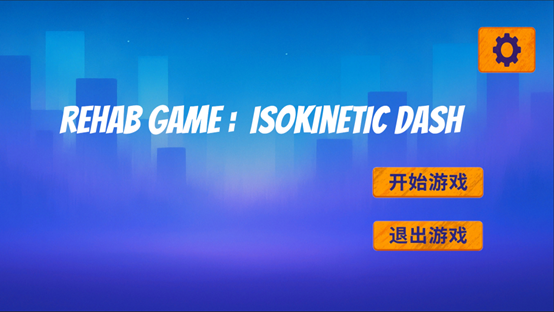
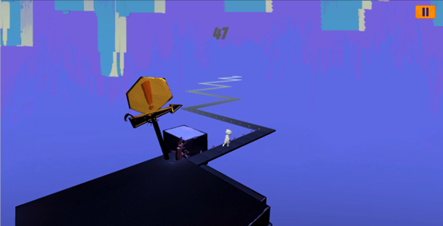
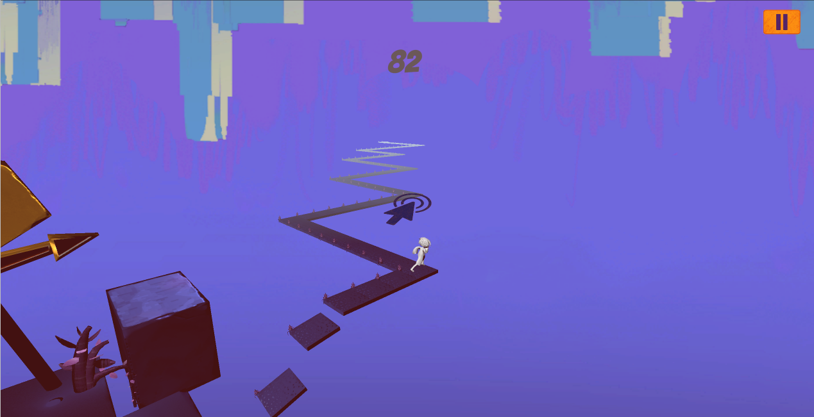
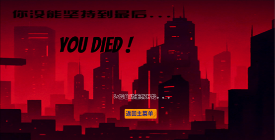
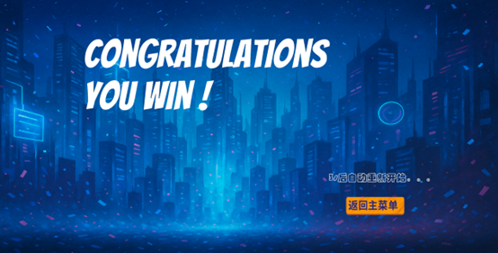

# Isokinetic Dash

Isokinetic Dash is a Unity 3D rehabilitation runner prototype designed around isokinetic wrist training for stroke rehabilitation. It explores how rehabilitation movements can be mapped to an intuitive runner game with clear feedback, making training easier to understand and follow.



## Download and Play

- Windows build: [IsokineticDash-Windows.zip](https://github.com/painfulmoments/isokinetic/releases/latest/download/IsokineticDash-Windows.zip)
- [Release page](https://github.com/painfulmoments/isokinetic/releases/tag/playable-v1.0.0)

Download and extract the entire ZIP before launching `IsokineticDash.exe`. Keep the executable, `UnityPlayer.dll`, `MonoBleedingEdge`, and `IsokineticDash_Data` together. Unity Hub and the Unity Editor are only needed to work with the source project.

## Project Overview

- Intended users: people undergoing wrist rehabilitation after a stroke
- Project type: Unity 3D rehabilitation runner and training interaction prototype
- Core goal: combine isokinetic rehabilitation training with lightweight runner gameplay
- Main scenes: `Assets/Scenes/Start.unity` and `Assets/Scenes/SampleScene.unity`
- Target platform: Windows

## Controls

- Hold the right mouse button: run / move forward
- Left mouse button: turn when the slow-motion turn prompt appears
- `Esc`: pause or resume the game

The current gameplay implementation primarily uses mouse input. Hold the right mouse button to move forward, then left-click when prompted at a corner to turn.

## Development Requirements

- Unity Hub
- Unity 2022.3.52f1c1
- Universal Render Pipeline (URP) 14.0.11
- Windows development environment

To test the rehabilitation hardware integration, additional components are required:

- PEAK PCAN drivers and runtime libraries
- External encoder / CAN hardware
- Optional Qt + UDP integration application
- Optional MySQL database environment

## Screenshots

Home screen:


Gameplay:





Win and failure screens:





## Highlights

- Designed around rehabilitation training goals
- Uses corners, slow-motion prompts, and rhythmic feedback to reinforce completed movements
- Retains external device integration modules for further rehabilitation system development
- Includes a main menu, pause controls, win and failure screens, and automatic restart behavior

## Project Structure

```text
isokinetic/
├─ Assets/
│  ├─ Plugins/                  # Third-party DLLs, including MathNet and MySql.Data
│  ├─ Resources/
│  │  ├─ Materials/
│  │  ├─ Player/
│  │  ├─ Prefabs/
│  │  ├─ TMP fonts/
│  │  └─ uiANDbackground/
│  ├─ Scenes/
│  │  ├─ Start.unity
│  │  └─ SampleScene.unity
│  ├─ Scripts/
│  │  ├─ Entity/
│  │  ├─ QtMysqlUDP/
│  │  ├─ ScriptsUDP/
│  │  └─ *.cs
│  └─ Sounds/
├─ config/
│  └─ config.ini
├─ docs/
│  ├─ images/
│  └─ PROJECT_GUIDE.md
├─ Packages/
└─ ProjectSettings/
```

## Key Systems

- `BallMovementController`: character movement, turning, win conditions, and restart behavior
- `GroundSpawnController`: road tile generation and replenishment
- `CornerTrigger`: corner detection and slow-motion timing
- `SlowMotionUI`: turn prompt interface
- `PauseController`: pausing and returning to the main menu
- `ReadConfig`: reads `config/config.ini`
- `EncoderManager`: encoder / CAN data acquisition and angle mapping

## Open the Source Project

1. Add the repository root as a project in Unity Hub.
2. Open it with Unity 2022.3.52f1c1.
3. Review `config/config.ini` and adjust the device, UDP, and database settings for your environment.
4. Open `Assets/Scenes/Start.unity`.
5. Click **Play** in the Unity Editor.

## Current Status

- Mouse input is the primary gameplay control path available for testing.
- Rehabilitation hardware and encoder modules remain in the project.
- Full hardware integration requires the corresponding devices, drivers, and external applications.

## Detailed Project Guide

For a more detailed project structure analysis, script responsibilities, peripheral integration, and handover notes, see [docs/PROJECT_GUIDE.md](docs/PROJECT_GUIDE.md) (in Chinese).
